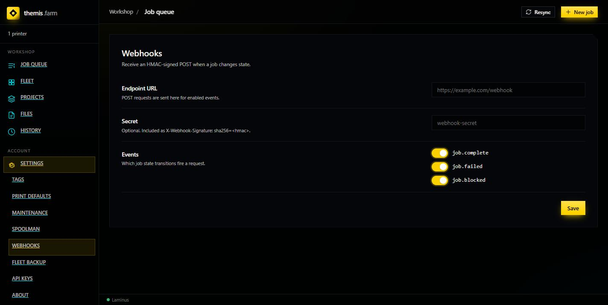

# Notifications

Getting told when a job finishes, fails, or blocks — without watching the queue.

---

## What's actually available

**A single signed webhook.** That's it in this build.

> The Themis README advertises built-in **ntfy, Discord, and email** channels. They are **not
> present** in the `:latest` image — there is no notifications route in the running API, and
> the only notification surface is `/api/v1/settings/webhook`. See
> [Where the READMEs are wrong](../reference/tips-and-faq.md#where-the-readmes-are-wrong).

You can still reach ntfy, Discord, or email — via the webhook plus a small relay. See
[below](#getting-to-discord-ntfy-or-email).

---

## Setting it up

**Settings → Webhooks** (click it in the sidebar — the route is `/settings/webhook`, singular,
and typing the plural silently shows Tags instead).



| Field | Purpose |
|---|---|
| **Endpoint URL** | Where the POST goes. |
| **Secret** | Optional. Used to sign the request — see below. |
| **Events** | Which transitions fire: `job.complete`, `job.failed`, `job.blocked`. All on by default. |

**Save** to apply.

---

## The events

| Event | Fires when | Worth alerting on? |
|---|---|---|
| `job.complete` | A print finished successfully. | Yes — it's your "go clear the plate" cue. |
| `job.failed` | Terminal error after slicing (upload/start failed). | **Yes.** Needs a human. |
| `job.blocked` | Job can't run right now — usually filament mismatch. | Maybe. Self-resolving, and chatty on a busy queue. |

`job.blocked` is the one to consider turning off first if you're getting too many alerts —
blocked jobs recover on their own once the right filament is loaded.

---

## Verifying the sender

If you set a **Secret**, Themis includes an HMAC signature header:

```
X-Webhook-Signature: sha256=<hmac>
```

The HMAC is computed over the request body using your secret. Your receiver recomputes it and
compares — if they match, the request genuinely came from Themis.

**Use a secret if the endpoint is reachable by anything but Themis.** Without one, anyone who
finds the URL can post fake "your print failed" messages. For a receiver bound to localhost on
the same machine it matters less.

---

## Testing it

The quickest check is a throwaway endpoint. <https://webhook.site> gives you a URL that
displays whatever it receives — paste it in, save, and run a job.

For something local, any tiny HTTP server that logs the body will do.

---

## Getting to Discord, ntfy, or email

Since the built-in channels aren't here, bridge the webhook:

| Target | Approach |
|---|---|
| **Discord** | Discord's own webhooks expect a specific JSON shape, so you need a small relay to reshape the payload — pointing Themis straight at a Discord webhook URL won't render correctly. |
| **ntfy** | ntfy accepts a plain POST body as the message; a thin relay mapping the JSON to a title + body works well. |
| **Email** | Relay to any transactional mail API or a local SMTP script. |
| **Home automation** | Home Assistant and Node-RED both accept generic webhooks directly — usually the least work. |

If you already run Node-RED or Home Assistant, that's the path of least resistance: point
Themis at it and fan out from there.

---

## Related: the plate-clear hook

Not a notification, but it pairs with one. Themis exposes:

```
POST /printers/{id}/plate-cleared
```

...which marks a printer ready for new work. Wire it to a QR code stuck on the printer, or a
button in your home automation, so clearing a plate doesn't mean walking back to the browser.

Combine: `job.complete` notifies you, you clear the plate, you scan the code, the printer takes
the next job.
