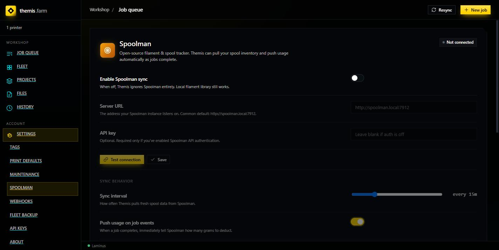

# Spoolman

[Spoolman](https://github.com/Donkie/Spoolman) is an open-source filament and spool tracker.
Connect it and Themis sources filament choices from your real inventory and reports usage back
as jobs complete.

**Entirely optional.** Themis has its own local filament handling and works fine without it.

---

## Settings

**Settings → Spoolman**

| Setting | Notes |
|---|---|
| **Enable Spoolman sync** | Master switch. Off = Themis ignores Spoolman entirely; the local filament library still works. |
| **Server URL** | Where your Spoolman lives. Common default: `http://spoolman.local:7912`. |
| **API key** | Only needed if you've enabled auth in Spoolman. Leave blank otherwise. |
| **Sync interval** | How often Themis pulls fresh spool data. Default 15 minutes. |
| **Push usage on job events** | When a job completes, tell Spoolman how many grams to deduct. |

**Test connection** before saving. The badge top-right shows `Not connected` until a
successful sync.

> **URL from Themis's point of view.** Themis runs in a container, so `localhost` means *the
> Themis container*, not your machine. If Spoolman runs on your host, use the machine's LAN IP
> (e.g. `http://192.168.1.50:7912`) or `http://host.docker.internal:7912`.

---

## What you get

**Filament choices from your catalogue.** Job filament comes from real spools you own, rather
than free-text you might typo.

**Per-filament OrcaSlicer profile mappings.** Store which OrcaSlicer filament preset goes with
each Spoolman filament — mapping is kept in Spoolman, so it survives a Themis reset. When a
job is bound to a spool, the right slicing profile follows automatically.

**Low-stock warnings.** A job bound to a spool warns on the job detail panel if the spool
doesn't have enough filament left.

**Usage push-back.** With push enabled, completed jobs deduct grams so your inventory stays
current without manual entry.

---

## How it interacts with the queue

Filament gating is unchanged by Spoolman: a job's required type and colour are matched against
each printer's **loaded filament**, and a mismatch blocks the job. Spoolman improves where the
*data* comes from — it doesn't change the rule.

For AMS printers, slot data syncs from the printer itself. Themis merges rather than
overwrites, so a slot's Spoolman spool binding and OrcaSlicer profile mapping survive an AMS
refresh. Slots the AMS stops reporting are dropped along with their mappings.

---

## Manual sync

**Sync now** forces an immediate pull instead of waiting for the interval. Useful right after
adding spools in Spoolman.

---

## Troubleshooting

| Symptom | Likely cause |
|---|---|
| `Not connected` after Test connection | URL wrong, or `localhost` used where a LAN IP is needed. |
| Connects, no filaments appear | Spoolman has no spools, or they're all archived. |
| Usage not deducting | **Push usage on job events** is off. |
| Mappings vanished after a Themis reset | They shouldn't — mappings live in Spoolman. Check you're pointed at the same instance. |
