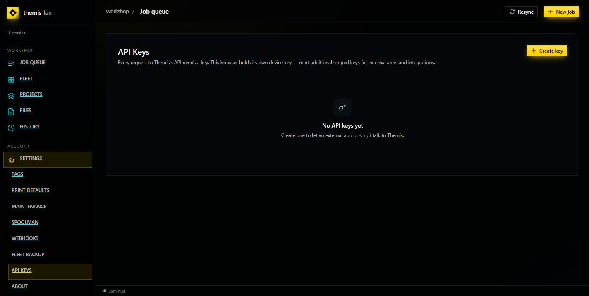
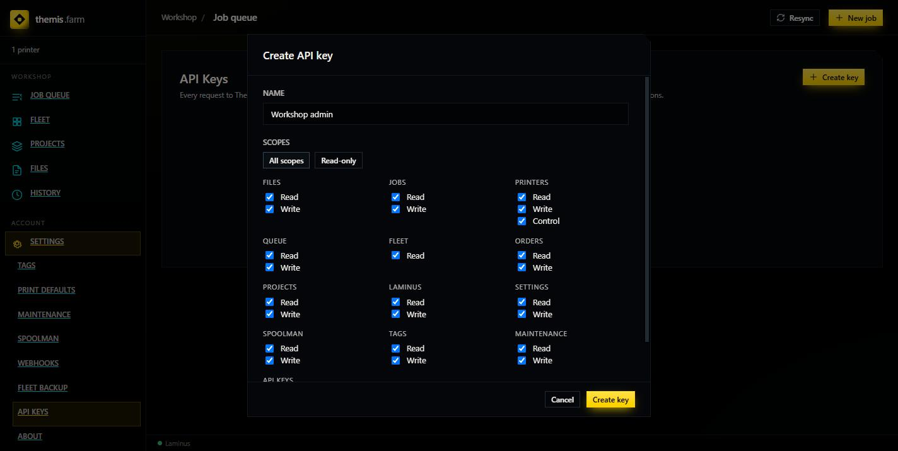
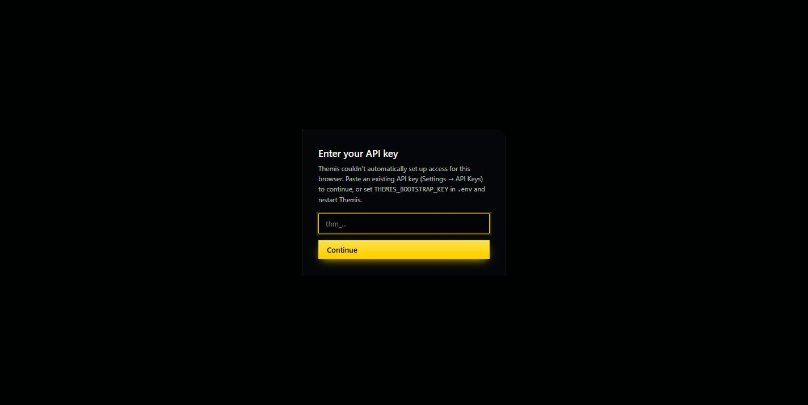

# First Login & Security

**Read this page before you open Settings → API Keys.** It describes the one action most
likely to lock you out of a fresh install.

---

## There is no login

Themis has no username, no password, no sign-in screen. Open `http://localhost:8001` and
you're in.

That is not an oversight — it's the bootstrap state. Themis protects its API with **API keys**,
and until the first key exists there is nothing to check against, so **every request is
served unauthenticated**.

Verified on a fresh install:

```bash
curl -s -o /dev/null -w "%{http_code}\n" http://localhost:8001/api/v1/printers
# 200   ← no key sent, request served
```

**What this means practically:** anyone who can reach port 8001 has full control of your print
farm — start prints, delete files, change settings. On a home network behind a router that's
usually acceptable. It is *not* acceptable if you forward the port through your router or run
it on a shared network.

> Do not expose Themis to the internet. It has no authentication until you create a key, and
> even afterwards it is designed for a trusted workshop network, not a hostile one.

---

## The first-key trap

Here is the part that bites people.

> ⚠️ **Creating your first API key immediately locks the browser you created it from — and
> the key's plaintext is never shown to you.**

What happens, step by step:

1. You go to **Settings → API Keys** and see an empty list.

   

2. You click **Create key**, name it, and pick scopes. The scope grid is genuinely nice —
   per-area Read/Write, plus **Control** for printers.

   

3. You click **Create key** — and instead of showing you the key, Themis drops you here:

   

The key was created. The bootstrap window is now closed, so every request needs a key:

```bash
curl -s -o /dev/null -w "%{http_code}\n" http://localhost:8001/api/v1/printers
# 401   ← same request as before, now rejected
```

But the plaintext key was never displayed. Only its prefix (e.g. `thm_G4pZA64t`) is
retrievable afterwards — key values are stored hashed, so **nothing can recover the full key
later**. You are locked out of the UI with no key to paste into the box that's asking for one.

### What doesn't work

Two things the on-screen message suggests, which were tested and did **not** work:

| Suggested | Result |
|---|---|
| Paste your `THEMIS_BOOTSTRAP_KEY` into the prompt | **"API key not recognized"** — the dialog rejects it, even though the same key works fine on the API via an `X-API-Key` header. |
| "Set `THEMIS_BOOTSTRAP_KEY` in `.env` and restart" | It was already set before startup, and the lockout happened anyway. |

After a page reload the prompt also starts claiming **"Couldn't reach the Themis server"** while
the server is demonstrably fine (`curl` succeeds). Don't trust that message — it does not mean
what it says.

---

## How to avoid it

**Pick one of these before you create any key.**

### Option A — Don't create a key at all (simplest)

If this is a single-user workshop on a trusted network, you don't need one. The bootstrap
state works fine. Leave API Keys alone.

### Option B — Create keys via the API, not the UI

The API returns the full plaintext key in its response, so you actually get to keep it.

With `THEMIS_BOOTSTRAP_KEY=your-key-here` set in `.env`:

```bash
# 1. See the available scopes
curl -s -H "X-API-Key: your-key-here" \
  http://localhost:8001/api/v1/api-keys/scopes

# 2. Create a key (at least one scope is required — an empty list is rejected)
curl -s -X POST http://localhost:8001/api/v1/api-keys \
  -H "X-API-Key: your-key-here" \
  -H "Content-Type: application/json" \
  -d '{"name":"My key","scopes":["queue:read","queue:write","printers:read"]}'
```

The response includes a `key` field — **that** is the plaintext, shown once. Save it in a
password manager immediately.

Be aware this still closes the bootstrap window: once any key exists, the browser will start
demanding one too.

---

## If you're already locked out

Ordered by how much you lose.

**1. Use the API instead of the UI.** Your `THEMIS_BOOTSTRAP_KEY` still works for every API
call via the `X-API-Key` header — it's only the browser dialog that rejects it. Everything
Themis can do is reachable this way.

```bash
curl -s -H "X-API-Key: your-key-here" http://localhost:8001/api/v1/api-keys
```

**2. Delete the keys to reopen the bootstrap window.** With no keys on file, Themis returns to
open access and the UI works again. Find the key IDs with the command above, then:

```bash
curl -X DELETE -H "X-API-Key: your-key-here" \
  http://localhost:8001/api/v1/api-keys/1
```

*Not verified end-to-end in the session that produced this guide* — the delete call was
blocked by a local permission policy before it could run. The endpoint exists
(`DELETE /api/v1/api-keys/{key_id}`) and the logic that opens the bootstrap window keys off
"no keys exist", so this should work. Confirm before relying on it.

**3. Full reset.** Guaranteed, but destroys everything — printers, jobs, files, history:

```bash
docker compose down -v
docker compose up -d
```

This also drops the cached OrcaSlicer AppImage, so the next start is slow again.

---

## Scopes, for when you do want keys

Scopes are per-area and split Read / Write, with an extra **Control** on printers (start,
pause, stop).

| Area | Read | Write | Control |
|---|---|---|---|
| Files, Jobs, Queue, Orders, Projects, Settings, Spoolman, Tags, Maintenance, Laminus, API Keys | ✅ | ✅ | — |
| Printers | ✅ | ✅ | ✅ |
| Fleet | ✅ | — | — |

**All scopes** and **Read-only** buttons set the whole grid at once. A read-only key is a good
fit for a dashboard that only displays status.

---

## Next

- [Verify It Worked](04-verify-it-worked.md)
- [Add a Printer](../using/add-a-printer.md)
