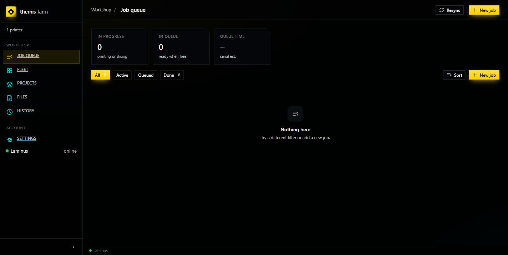
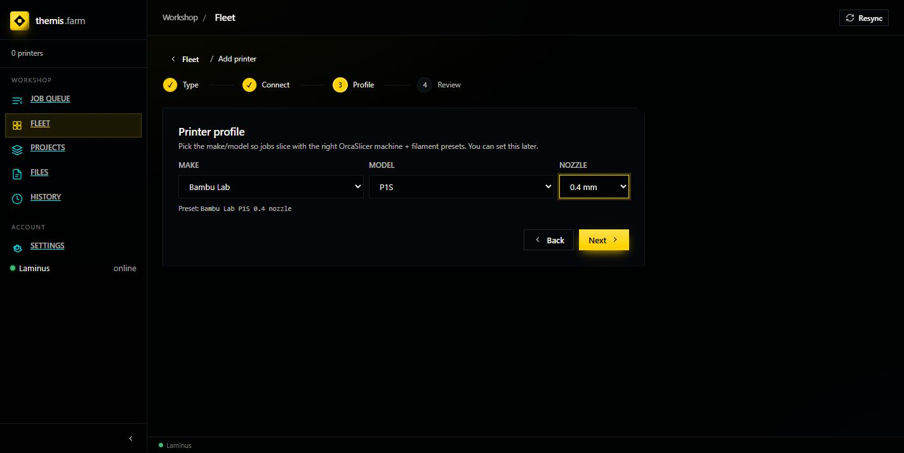
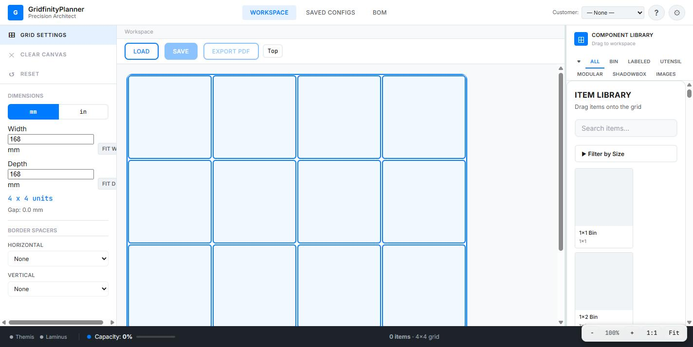

# Verify It Worked

A checklist to confirm the install is actually functional — not just that pages load.

Work top to bottom. Each check tells you what a failure means.

---

## 1. All three containers healthy

```bash
docker compose ps
```

✅ **Pass:** all three show `Up (healthy)`.

❌ `health: starting` on Laminus — still warming up. Normal for the first 5–10 minutes of a
cold start. Wait, don't restart.

❌ `themis` or `ordinus` missing entirely — they never started because their dependency isn't
healthy. Fix Laminus first; the others follow automatically.

---

## 2. Themis answers

```bash
curl http://localhost:8001/api/v1/health
```

✅ **Pass:** `{"status":"ok"}`

❌ Connection refused — Themis isn't running, or `HOST_PORT` in `.env` isn't `8001`. Check
with `docker compose ps` which host port is actually mapped.

---

## 3. Ordinus answers

```bash
curl http://localhost:3002/api/v1/health
```

✅ **Pass:** `{"data":{"status":"ok","version":"1.0.0","uptime":...}}`

❌ Connection refused — check `ORDINUS_PORT` in `.env`. Note the default in `.env.example`
(`3002`) differs from the fallback baked into `docker-compose.yml` (`3001`); if you deleted
your `.env`, Ordinus is on 3001.

---

## 4. Laminus has built its catalog

**This is the check that matters most** — Laminus answers HTTP well before it can actually
slice anything.

It has no host port, so go through the container:

```bash
docker compose exec laminus python3 -c \
  "import json,urllib.request as u; print(json.dumps(json.load(u.urlopen('http://localhost:5000/api/health')),indent=2))"
```

✅ **Pass:** `catalog_loaded` is `true` and `catalog_profile_count` shows real numbers:

```json
{
  "status": "healthy",
  "orcaslicer_installed": true,
  "config_mounted": true,
  "catalog_loaded": true,
  "catalog_building": false,
  "catalog_profile_count": {
    "machine": 1545,
    "process": 3201,
    "filament": 6475
  },
  "catalog_skipped_count": 705,
  "active_jobs": 0
}
```

Your counts will differ with the OrcaSlicer version — the shape is what matters.

❌ `catalog_building: true` — still scanning. Wait.

❌ `catalog_loaded: false` and `catalog_building: false` — the scan failed.
`docker compose logs laminus`.

❌ `orcaslicer_installed: false` — the AppImage download failed, usually a network problem on
first start. `docker compose restart laminus` to retry.

> **Ignore `orcaslicer_version`.** It commonly reads `"Invalid option --version"` — the
> OrcaSlicer build doesn't support that flag. It's cosmetic and does not indicate a problem.
> `orcaslicer_installed: true` is the real signal.

---

## 5. Themis can see Laminus

Open <http://localhost:8001> and look at the bottom of the left sidebar.

✅ **Pass:** `Laminus` with a green dot and **online**.



❌ Offline or missing — Themis is up but can't reach the slicer. Every slice will fail while
the UI otherwise looks fine. See
[Troubleshooting](05-troubleshooting.md#laminus-shows-offline-in-themis).

---

## 6. The profile catalog reaches the UI

This proves the whole chain — Laminus scanned the profiles, Themis fetched them, the browser
rendered them.

1. **Fleet → Add printer**
2. Pick any type, click through to step 3 (**Profile**)
3. Open the **MAKE** dropdown

✅ **Pass:** a long vendor list — Bambu Lab, Creality, Elegoo, Prusa, Voron, and ~80 more.
Pick a make and the **MODEL** list populates; pick a model and **NOZZLE** offers 0.2/0.4/0.6/0.8.



*The grey line underneath — `Preset: Bambu Lab P1S 0.4 nozzle` — is the resolved OrcaSlicer
preset. Seeing that means the full path works.*

❌ Empty MAKE dropdown — Themis reached Laminus but got no catalog. Re-check step 4.

You can cancel out of the wizard; nothing is saved until you click **Finish**.

---

## 7. Ordinus loads and sees its neighbours

Open <http://localhost:3002>.

✅ **Pass:** the workspace grid renders, and the bottom-left status bar shows **Themis** and
**Laminus** indicators.



---

## All seven pass?

You're done — the stack is fully functional.

- [Add a Printer](../using/add-a-printer.md)
- [Your First Print](../using/first-print.md)
- [Themis Tour](../using/themis-tour.md)

Any failures → [Troubleshooting](05-troubleshooting.md).
