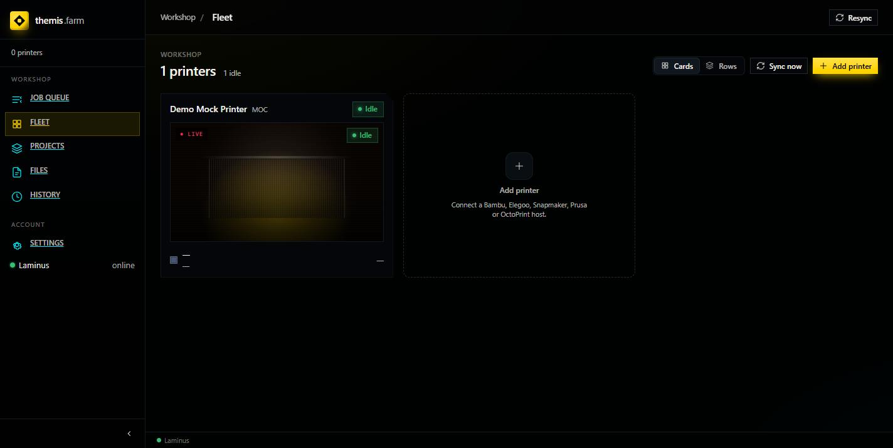

# Add a Printer

**Fleet → + Add printer** opens a four-step wizard: **Type → Connect → Profile → Review**.
Nothing is saved until you click **Finish**, so it's safe to click through and cancel.

---

## Step 1 — Type

Pick the vendor, and give the printer a nickname (shown in the queue and on tiles).

The types actually available:

| Type | Protocol | Notes |
|---|---|---|
| **Bambu Lab** | MQTT / FTPS | AMS slots sync automatically. |
| **Elegoo Centauri** | SDCP over WebSocket | |
| **Snapmaker U1 (Extended)** | Moonraker / Klipper | Multi-tool; per-filament tool mapping. |
| **Mock Printer (Testing)** | none | A fake printer. No hardware, no network. |

> The Fleet empty-state text mentions Prusa and OctoPrint. **Those are not implemented** in
> this build — the four above are the whole list.

**Mock Printer** is genuinely useful: it lets you exercise the queue, slicing, and the whole
job lifecycle before any hardware arrives, and it's how the screenshots in this wiki were made.

---

## Step 2 — Connect

Connection details, which differ per vendor — the form renders from what the selected client
declares it needs, so you only ever see relevant fields.

Mock Printer needs nothing, so the step is empty.

Real printers need at least a host/IP, plus vendor specifics:

| Vendor | Typically needs |
|---|---|
| Bambu Lab | IP address, access code, serial number |
| Elegoo Centauri | IP address |
| Snapmaker U1 | IP address / Moonraker endpoint |

Find the IP on the printer's own screen (network settings) or in your router's client list.
A static lease is worth setting up — if the printer's IP moves, Themis loses it.

**Test connection** verifies before you commit.

---

## Step 3 — Profile

This is the important one. **Make → Model → Nozzle** narrows OrcaSlicer's catalog down to a
single machine preset, shown underneath as e.g. `Preset: Bambu Lab P1S 0.4 nozzle`.

That preset is what jobs for this printer get sliced with. It's how Themis slices with *your
real presets* instead of generic settings.

The dropdowns are populated live from Laminus, so:

- An **empty Make list** means the catalog isn't ready —
  [check it](../setup/04-verify-it-worked.md#4-laminus-has-built-its-catalog).
- The lists are cascading: pick Make before Model, Model before Nozzle.

The step is **optional now, required before this printer can slice** — you can finish without
it and set it later via Fleet → edit printer. A printer with no profile will block every job
it tries to claim.

> **Make names can look odd.** Names are derived from OrcaSlicer's machine-profile names, so
> you'll see both `Elegoo` and `Elegoo Centauri Carbon` as separate "makes", and some entries
> whose Model list is a fragment like `2`. If a make gives a nonsensical model list, try the
> shorter or longer variant of the vendor name.

---

## Step 4 — Review

Confirm Type, Nickname, and Printer profile, then **Finish**.

The printer appears on Fleet immediately, with live status.

---

## After adding

Two things to set before the printer can usefully take work:

1. **Loaded filament** — on the printer's Fleet card. Themis matches a job's filament
   requirement (type *and* colour) against this. Wrong or empty is the most common cause of a
   [blocked job](first-print.md#blocked-vs-failed). Bambu AMS slots populate automatically.
2. **Queue on** — whether this printer may claim jobs automatically. Off is useful while
   you're still setting it up.

---

## Adding a printer Themis doesn't support

Support is one client class plus one registry entry — everything downstream (fleet, queue,
slicing) is vendor-agnostic. See `themis/docs/agent/printers.md` for the contract.
