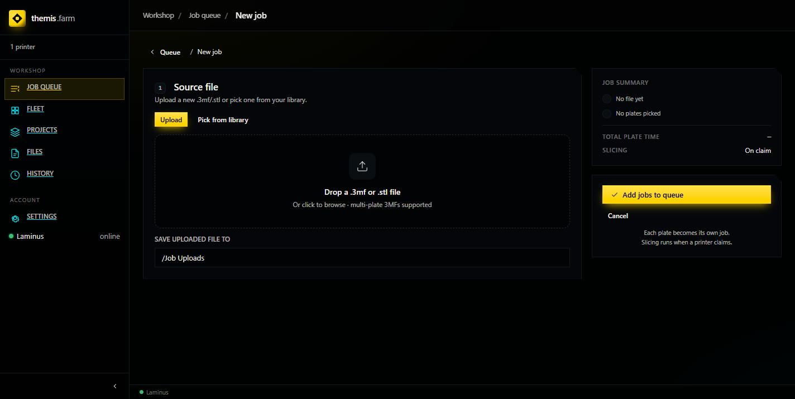

# Your First Print

Upload a model, queue it, and understand what happens next.

**Before you start:** at least one printer on Fleet with a machine profile set
([Add a Printer](add-a-printer.md)), and its loaded filament recorded.

---

## The flow

```
Upload .3mf/.stl
      │
      ▼
Pick eligible printers + process profile + filament ──▶ enqueue
      │
      ▼
Queue engine waits for an idle, eligible printer
      │
      ├── filament or slice mismatch ──▶ BLOCKED  (stays queued, retried)
      │
      ▼
Slice for THIS machine ──▶ upload ──▶ start ──▶ printing ──▶ complete
      │
      └── slice fails ──▶ retry geometry-only ──▶ still fails ──▶ BLOCKED
```

Note what's *not* here: you never pick which printer runs the job. You declare which printers
are *allowed*, and the queue engine assigns.

---

## Step 1 — Start a job

**+ New job** from the Queue screen.



**Upload** a `.3mf` or `.stl`, or **Pick from library**. `Save uploaded file to` chooses the
library folder — `/Job Uploads` by default.

**3MF vs STL.** A 3MF can carry multiple plates, per-object settings, and colour assignments;
an STL is raw geometry. Prefer 3MF exported from OrcaSlicer when you have it. **Each plate in
a multi-plate 3MF becomes its own job.**

---

## Step 2 — Configure

Once a file is attached, configure each plate:

| Setting | What it does |
|---|---|
| **Eligible printers** | Which printers *may* run this. More = more scheduling freedom. |
| **Print profile** | The OrcaSlicer process preset — layer height, speed, infill. |
| **Filament** | Type and colour required. Matched against printers' loaded filament. |
| **Order link** | Optionally attach to an order. |

The right-hand **Job summary** tracks readiness and shows `Slicing: On claim`.

> **Why "on claim"?** The job is sliced for the machine that actually takes it. Allowing three
> different printers means three possible slices — computed when one commits, not three times
> up front.

---

## Step 3 — Queue it

**Add jobs to queue.** The job appears on the Queue screen with a status badge, and the
counters update.

From here it's automatic: a printer goes idle, the engine checks eligibility, and if
everything matches it slices, uploads, and starts.

---

## Blocked vs failed

The distinction that matters most.

| Status | Meaning | Recovers on its own? |
|---|---|---|
| **Blocked** | Can't run *right now*. Stays queued, re-evaluated every cycle. | **Yes** — fix the cause and it proceeds. |
| **Failed** | Post-slice upload or start error. Terminal. | No — needs intervention. |

**Blocked is normal and not an error.** The most common cause is filament: the job asks for
Black PLA, the printer has Grey PETG loaded. Load the right spool and the job unblocks itself
on the next cycle — no clicking required.

A slice failure also blocks rather than fails, because a different eligible printer might
still manage it.

### Head-of-line behaviour

If the first eligible job can't run on a free printer, **that printer waits** rather than
skipping to a later job. Deliberate — it stops a big awkward job being starved forever by a
stream of easy ones. If a printer is idle while jobs are queued, look at the *first* job.

---

## The plate-clear hold

When a print finishes, the printer is flagged not-ready and **won't claim the next job** until
you confirm the plate is clear. Otherwise it would print onto the finished part.

Fleet → the printer's card → **Ready for new work**.

There's also an API hook (`POST /printers/{id}/plate-cleared`) if you'd rather wire it to a QR
code or home automation.

---

## Watching it

- **Queue** — badges and counters, live.
- **Fleet** — camera and telemetry for the printing machine.
- **Job detail** — click a job for per-printer slicing config and any error.
- **History** — where it lands when done, with an outcome note on failure.

---

## First print checklist

1. Printer on Fleet, `Idle`
2. Machine profile set (Fleet → edit → make/model/nozzle)
3. Loaded filament recorded, matching what's physically in the machine
4. Laminus shows **online** in the sidebar
5. Queue-on enabled for the printer

If a job sits **queued** and never claims, one of 1–5 is off. If it goes **blocked**, open it —
the reason is stated.
