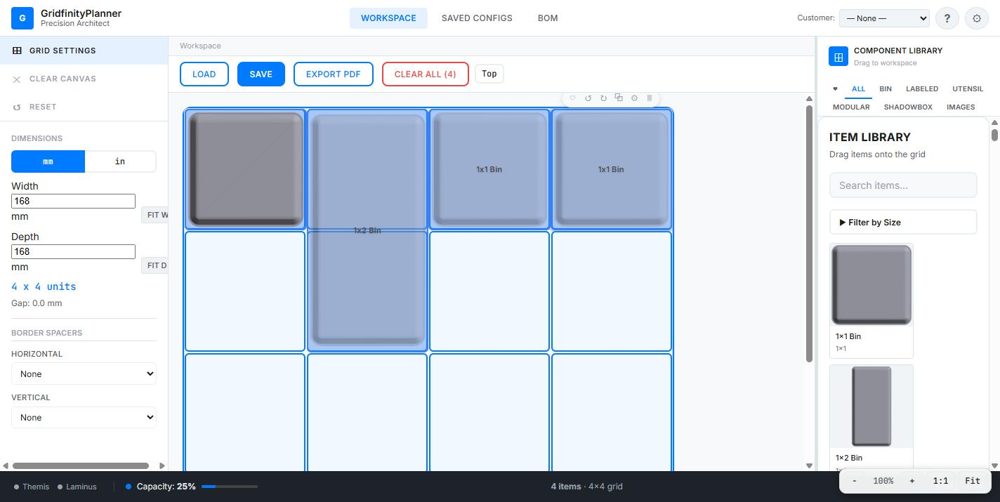
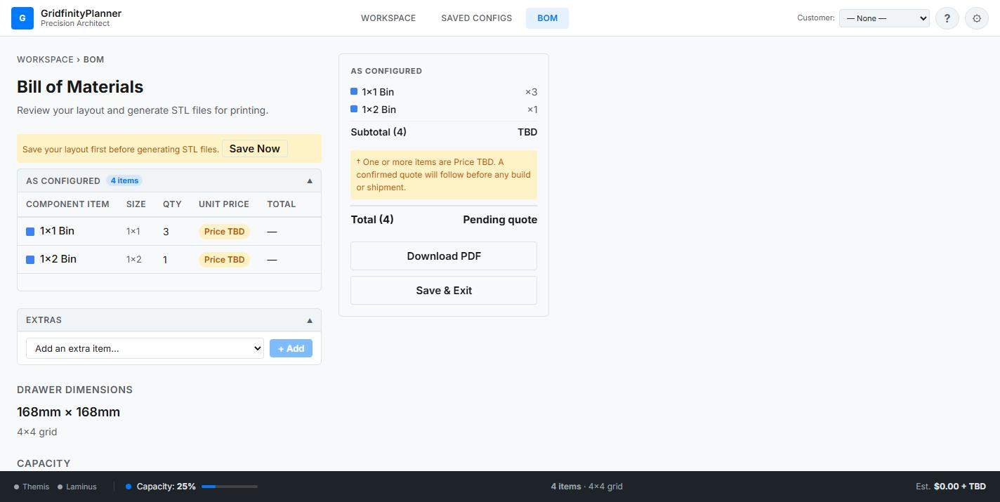

# Ordinus — Gridfinity Layouts

Design a drawer full of modular storage bins, get a bill of materials, send it to Themis to
print.

Open at <http://localhost:3002>.

---

## What Gridfinity is

An open-source modular storage system for 3D printing. Every bin snaps into a baseplate on a
**42 mm grid**, so anything you lay out here maps directly to physical parts you can print.

Ordinus lets you plan the whole drawer before printing a single bin — which matters, because
printing a drawer's worth of bins is many hours of machine time.

---

## The workspace


Three regions:

| Region | Contains |
|---|---|
| **Left — Grid Settings** | Drawer dimensions, unit toggle, border spacers. |
| **Centre — the grid** | Your drawer. Drag bins here. |
| **Right — Component Library** | Available bin types, filtered and searchable. |

The bottom status bar shows **Themis** and **Laminus** indicators, item count, and capacity.

---

## 1. Set your drawer size

Enter the **interior** dimensions of your real drawer in mm (or switch to inches). The summary
updates live:

```
4 x 4 units
Gap: 0.0 mm
```

That means four 42 mm units fit each way, with nothing left over. **Gap** is the leftover
space — useful for knowing whether bins will slide around.

**FIT W** / **FIT D** snap to the nearest whole unit count when your drawer isn't an exact
multiple of 42 mm.

**Border spacers** (horizontal / vertical) account for drawer walls or lips that eat usable
space.

---

## 2. Place bins

Drag from the Component Library onto the grid. Categories — **All / Bin / Labeled / Utensil /
Modular / Shadowbox** — plus search and a size filter.



Placement feedback is colour-coded: a valid drop outlines green, an overlap outlines red.

Select a placed bin for an inline toolbar: **rotate** CW/CCW, **customize** (height in
Gridfinity units, wall cutout sides, per-type options), **favourite**, **duplicate**,
**delete**.

**Favourites** are worth knowing about — hearting a *customized* bin saves that configuration,
and you can drag it back out of the Favorites tab later rather than re-customizing.

---

## 3. Reference images (optional)

To design around tools you already own: **Images** tab → upload a photo of the drawer or its
contents, then position, scale, and rotate it to match the grid. Adjust **opacity** to see the
grid through it, and **lock** it once aligned so you don't nudge it while placing bins.

---

## 4. Save

| Situation | Action |
|---|---|
| Never saved | **Save** → name it |
| Saved, with edits | **Save** overwrites; an amber "unsaved changes" dot shows pending edits |
| Want a copy | Long-press **Save** (or the save-as-new dialog) |

**Saved Configs** lists everything, to load or clone.

---

## 5. Bill of materials

The **BOM** tab totals what you've designed.



Counts per bin type, drawer dimensions, and capacity. **Download PDF** exports a print-ready
summary. Pricing shows `Price TBD` unless a catalogue with prices is configured — expected,
not an error.

> **Save before generating.** The BOM screen will tell you to save the layout first if you
> haven't — STL generation works from the saved layout.

---

## Sending to Themis

**Send to Themis** pushes the BOM's STLs into a Themis project:

1. Each unique STL uploads to the Themis library (deduplicated by content, so re-sends are
   cheap).
2. A project is created — or **resumed**, if you've sent this layout before.
3. Project items are added for parts not already there.
4. A backlink to the Ordinus layout is attached.

Two behaviours worth knowing:

- **Re-sending resumes.** Send the same layout twice and you update the existing project
  rather than creating a duplicate.
- **Shared models deduplicate across layouts.** All Ordinus files land in one flat
  `/Gridfinity` folder specifically so the same bin used in three different drawers is stored
  once.

> ⚠️ **Ordinus never assigns filament.** Every send lands in Themis needing filament set on
> its parts before jobs can be generated. Expected — Ordinus doesn't know what's on your
> shelf.

There's no authentication between Ordinus and Themis; they're assumed to be on the same
trusted network.

---

## Keyboard shortcuts

| Key | Action |
|---|---|
| `Delete` / `Backspace` | Delete selection |
| `R` / `Shift+R` | Rotate CW / CCW |
| `Ctrl+D` | Duplicate |
| `Ctrl+C` / `Ctrl+V` | Copy / paste |
| `Ctrl+A` | Select all |
| `Esc` | Deselect |
| `V` | Toggle ortho / 3D |
| `L` | Lock/unlock reference image |
| `+` / `-` | Zoom |
| `Ctrl+0` | Reset zoom |
| `Space + drag` | Pan |
| `?` | Shortcut reference |

---

## Mobile

On screens ≤ 1024 px a bottom tab bar replaces the desktop toolbar (Load, Save, Export,
Ortho/3D, Clear). Touch pan and pinch-zoom work on the canvas. **Long-press Save** opens
Save-as-New instead of overwriting.
