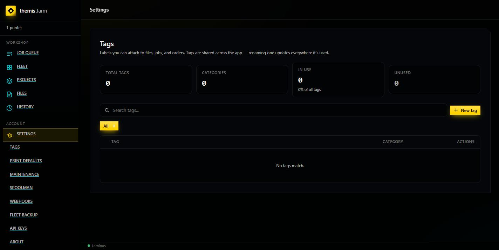
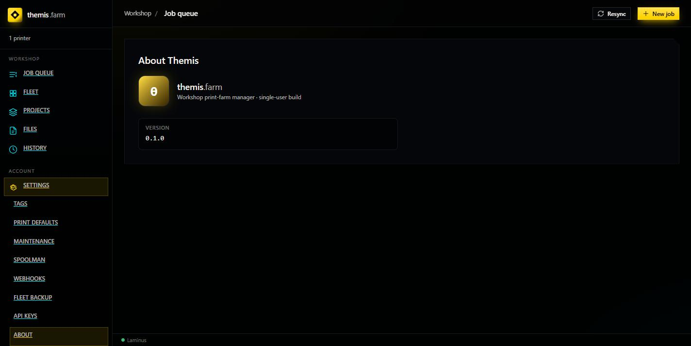

# Themis Tour

What each screen is for. Themis is the app you'll spend nearly all your time in.

---

## Layout

Left sidebar = navigation, in two groups:

| Group | Items |
|---|---|
| **Workshop** | Job Queue · Fleet · Projects · Files · History |
| **Account** | Settings |

Below those, a live **Laminus** indicator. Green/online means slicing works. If it's offline,
the app still loads but every slice fails — see
[Troubleshooting](../setup/05-troubleshooting.md#laminus-shows-offline-in-themis).

Top-right carries **Resync** and **+ New job** on most screens.

---

## Job Queue

The default screen and the heart of the app — one shared list of work for every printer.

Three counters across the top:

| Counter | Meaning |
|---|---|
| **In progress** | Printing or slicing right now. |
| **In queue** | Waiting for a free, eligible printer. |
| **Queue time** | Rough serial estimate to work through the queue. |

Filters — **All / Active / Queued / Done** — plus **Sort**.

You don't assign jobs to printers. A background engine watches for an idle, eligible printer
and claims the next job for it. Your job is to describe what's needed; Themis routes it.

---

## Fleet

Your printers, as live cards.

Each card shows the printer's name, live status badge (`Idle`, printing, etc.), and a camera
view for printers that have one. **Cards / Rows** toggles density; **Sync now** forces a
refresh; **+ Add printer** opens the wizard ([Add a Printer](add-a-printer.md)).

Two things you'll use often:

- **Ready for new work** — after a print finishes, a printer is held until you confirm the
  plate is clear. This button releases it. It's why a finished printer sometimes "won't take"
  the next job.
- **Loaded filament** — what's actually in the machine. Themis matches this against each job's
  requirements, so a wrong entry here is the most common cause of a blocked job.

> The card header count reads `1 printers` and the sidebar count can lag until you reload.
> Cosmetic.

---

## New Job

Reached from **+ New job**. Where work enters the system.

Step 1 is the source file — **Upload** a `.3mf` or `.stl`, or **Pick from library** if it's
already in Files. Multi-plate 3MFs are supported, and **each plate becomes its own job**.

The right-hand **Job summary** tracks readiness as you go, and notes `Slicing: On claim` —
slicing happens when a printer claims the job, not at upload. That's deliberate: the job is
sliced for *the specific machine that will print it*, so the same job can be sliced
differently depending on who picks it up.

`Save uploaded file to` sets the library folder, defaulting to `/Job Uploads`.

Full walkthrough: [Your First Print](first-print.md).

---

## Projects

Batch work. Build a bill of materials — parts, quantities, filament requirements, printer
eligibility — then generate the jobs and a linked order in one step, with parts packed across
plates.

This is also where Ordinus layouts land when you send them over.
See [Projects & Orders](projects-and-orders.md).

---

## Files

Your model library: a folder tree over uploaded `.3mf` and `.stl` files, with search, tags,
rename, and download. Uploads from New Job land here, as do files pushed from Ordinus.

Files are deduplicated by content within a folder, so re-sending the same model is cheap
rather than creating duplicates.

---

## History

Finished work — completed, failed, and cancelled jobs. Failures carry an outcome note
explaining what went wrong.

---

## Settings

Its own sub-navigation:

| Panel | What it's for |
|---|---|
| **Tags** | Shared labels across files, jobs, and orders. Renaming one updates every use. |
| **Print Defaults** | Workshop-wide defaults for new jobs. |
| **Maintenance** | Maintenance items on calendar / job-count / job-time triggers. Due items surface on Fleet. |
| **Spoolman** | Filament inventory sync — [details](../integrations/spoolman.md). |
| **Webhooks** | Signed HTTP callbacks on job events — [details](../integrations/notifications.md). |
| **Fleet Backup** | Export/import your fleet configuration. Worth doing once set up. |
| **API Keys** | Scoped keys. **[Read the warning first](../setup/03-first-login.md).** |
| **About** | Version. |

> **Navigate Settings by clicking**, not by typing URLs — the paths aren't all guessable
> (`/settings/webhook` is singular), and an unknown one silently shows Tags.

---

## What's not here

The Themis README describes an **Orders** screen in the main navigation and built-in **ntfy,
Discord, and email** notification channels. Neither is present in the `:latest` image this
wiki was written against — orders exist but are reached through Projects, and webhooks are the
only notification mechanism. See
[Where the READMEs are wrong](../reference/tips-and-faq.md#where-the-readmes-are-wrong).
